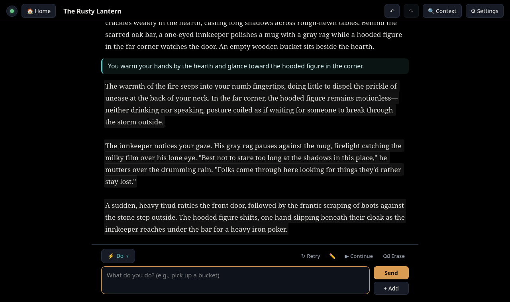
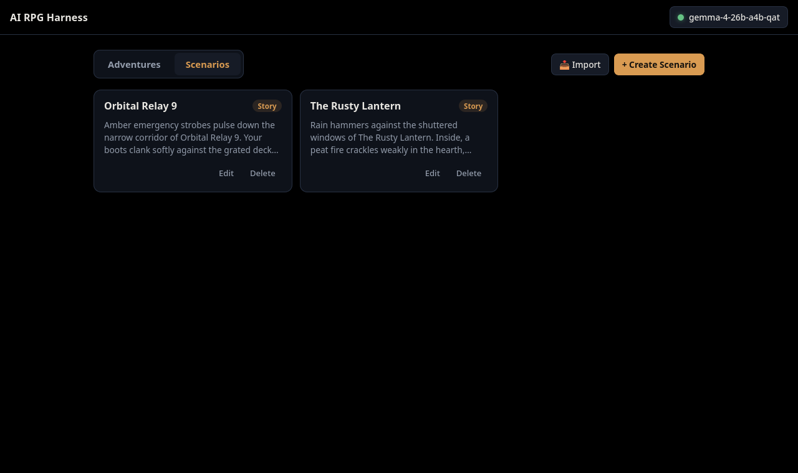
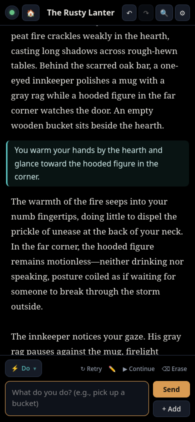

<div align="center">

# AI RPG Harness

**Play unlimited, private, AI Dungeon-style text adventures on your own computer—or from your phone.**

*Self-hosted · Zero Python dependencies · Local & Cloud AI · Desktop & Mobile*

[](https://www.python.org/)
[](https://nodejs.org/)
[](LICENSE)

[Features](#features) · [Installation](#installation) · [How to Play](#how-to-play) · [Technical Information](#technical-information)

<br />



*Inline dark-mode prose, styled character actions, and quick turn controls.*

</div>

---

AI RPG Harness gives you a clean, distraction-free dark-mode home for interactive storytelling. Connect it to a local AI running on your own hardware—or plug in an OpenAI-compatible cloud API—and start playing right away. No subscriptions, no accounts, and no `pip install` needed.

> [!NOTE]
> **Disclosure:** All code in this repository was generated with AI assistance.

> [!WARNING]
> **Safety Notice:** This app has no login screen and runs JavaScript scenario scripts on your machine. Only run it on your own computer (`localhost`) or a private network like Tailscale, and only use scripts you trust.

---

## Features

### 📖 Smooth, Distraction-Free Gameplay
- **Inline Prose & Styled Actions:** Stories read like a book on a deep dark-mode canvas, with your **Do** and **Say** actions clearly highlighted.
- **4 Ways to Steer the Story:** Switch anytime between **Do** (take an action), **Say** (speak dialogue), **Story** (write narration directly), and **Guide** (give the AI a one-turn behind-the-scenes direction).
- **Total Turn Control:** **Undo**, **Redo**, **Continue**, **Erase**, **Retry**, and **Retry with changes** (tell the AI exactly what to tweak in its last reply).
- **Queue Multiple Beats:** Use **`+ Add`** to stack actions or dialogue without triggering the AI yet, then press **Continue** or **Send** when you're ready.
- **Swipe Between Retries:** Swipe sideways on mobile (or use `‹` / `›` on desktop) to flip between different versions of the latest AI response.
- **Edit Any Turn:** Hover over a message on desktop—or tap it on mobile—to **Edit**, **Delete**, **Erase to Here**, **Change Name** (in Third Person mode), or **View Context**.

### 🗺️ Scenarios, Choices & Characters
- **Ready Out of the Box:** Comes with two starter worlds (*The Rusty Lantern* and *Orbital Relay 9*) in a clean **Adventures / Scenarios** home hub.
- **Three Scenario Types:**
  - **Story:** Classic opening prompt with fill-in-the-blank `${placeholder}` questions and optional Third Person mode.
  - **Multiple Choice:** Multi-level branching paths where each choice can bring its own opening, lore, Story Cards, and scripts.
  - **Character Creator:** Step-by-step hero builder—or click **Quickstart** to roll a random character and jump straight into the story.
- **Import from AI Dungeon:** Import `.json` scenario files (`metadata.json`) or pull public scenarios directly from a `play.aidungeon.com` URL.

<p align="center">
  
  <br />
  <sub>The Home hub: jump into any scenario with a click, create your own, or import from AI Dungeon.</sub>
</p>

### 🧠 Memory That Keeps Up With Long Stories
- **Story Cards:** Save characters, places, factions, and items that automatically feed into the AI whenever their keywords come up (or pin key cards so they're always active). Generate card entries with AI or import/export `.json` card decks.
- **Plot Controls:** Shape the AI with **AI Instructions**, **Plot Essentials**, **Author's Note**, and **Story Summary** (with one-click **Auto-Summarize**).
- **Automatic Long-Term Memory:** Turn on **Auto Summarization** and the **Memory Bank** so the AI remembers important events from much earlier in your campaign.
- **Context Viewer:** Click **Context** anytime to see exactly what the AI is reading, how much memory is used, and any warnings.

### 🔌 Any AI, Any Device, Extra Add-ons



- **Local or Cloud AI:** Works with **llama.cpp**, **Ollama**, **LM Studio**, **vLLM**, **OpenRouter**, **OpenAI**, and other OpenAI-compatible servers. Switch endpoints or models right inside the app—no restart needed.
- **Smart Model Adaptation:** Automatically detects your model's maximum context window and shows the right **Thinking / Reasoning** control (either a 5-step effort slider or a simple on/off toggle) when supported.
- **One-Click Community Scripts:** Toggle **🎭 Inner Self** (NPC memory, goals, and secrets) and **✨ Auto-Cards** (automatic Story Card creation) right when starting an adventure, or write and test your own JavaScript hooks.
- **Play on Your Phone:** Responsive mobile layout with swipe gestures and one-command [Tailscale](https://tailscale.com/) support so you can keep playing from anywhere.
- **Instant Auto-Save & `.zip` Backups:** Every setting change saves automatically, and you can download any adventure as a `.zip` backup anytime.

<br clear="right" />

---

## Installation

### What You Need
- **Python 3.10+** *(uses only Python's built-in library—nothing to `pip install`)*
- **Node.js 18+** *(used for scenario scripts and optional URL imports)*
- **An AI model to connect to:** a local server like [`llama.cpp`](https://github.com/ggml-org/llama.cpp) (`llama-server`), **Ollama**, **LM Studio**, or **vLLM**—or a cloud API key (such as **OpenRouter** or **OpenAI**)
- *(Optional)* **Playwright + Firefox** — only needed if you want to import scenarios directly from `play.aidungeon.com` links

### 1. Clone the Repository

```bash
git clone https://github.com/ya5h-P/AI-RPG-Harness.git
cd AI-RPG-Harness
chmod +x start.sh
```

### 2. *(Optional)* Enable AI Dungeon URL Imports

Skip this if you only create your own scenarios or import `.json` files:

```bash
npm install
npx playwright install firefox
```

### 3. Start Your Local AI *(or Skip for Cloud APIs)*

If you're running a local model, start your server first (AI RPG Harness checks `http://127.0.0.1:8080` by default). For example, with `llama.cpp`:

```bash
llama-server -m /path/to/your-model.gguf --port 8080 -c 32768
```

### 4. Start the App

**On your computer:**

```bash
./start.sh
```

Open **http://127.0.0.1:7860** in your browser.

**To play from your phone over Tailscale:**

Make sure [Tailscale](https://tailscale.com/) is connected on both your computer and your phone, then run:

```bash
./start.sh --tailscale
```

`start.sh` prints your Tailscale IP URL (e.g. `http://100.x.y.z:7860`) and MagicDNS URL (`http://<hostname>.ts.net:7860`). Open either link on your phone.

### Everyday Commands

```bash
./start.sh --bg --tailscale   # Run in the background (logs to logs/server.log)
./start.sh status             # Check AI server & Web UI health + show phone URL
./start.sh stop               # Stop the background server
./start.sh test               # Run the automated test suite
./start.sh --help             # Show all options
```

---

## How to Play

### 1. Connect Your AI Model
On the Home screen, look at the button in the **top-right corner**—a **green dot** with your model's name means you're ready to play.

To connect to Ollama, LM Studio, or a cloud provider:
1. Click the **Model** button in the top-right corner of the Home screen *(or click the status dot in the top-left during an adventure)*.
2. Enter your **Base URI**:
   - **llama.cpp:** `http://127.0.0.1:8080`
   - **Ollama:** `http://127.0.0.1:11434/v1`
   - **LM Studio:** `http://127.0.0.1:1234/v1`
   - **OpenRouter:** `https://openrouter.ai/api/v1`
   - **OpenAI:** `https://api.openai.com/v1`
3. Add your **API Key** if required, click **↻ Fetch** to choose a model, and click **Save & Connect**.

### 2. Start an Adventure
- Switch between **Adventures** (saved stories) and **Scenarios** (starter worlds, custom scenarios, or imported scenarios).
- Click any scenario card to start playing—or use **+ Create Scenario** and **📥 Import** in the top-right.
- On the setup screen, you can also toggle **🎭 Inner Self** and **✨ Auto-Cards** on with a single click before starting.

### 3. Take Turns & Steer the Story
Click the mode pill at the bottom-left (or use keyboard shortcuts) to choose how your turn is sent:

| Mode | Shortcut | What It Does |
| :--- | :---: | :--- |
| ⚡ **Do** | `Alt+1` | Take an action (auto-formatted like `You warm your hands by the hearth.`). |
| 💬 **Say** | `Alt+2` | Speak dialogue (auto-formatted like `You say, "Who goes there?"`). |
| 📖 **Story** | `Alt+3` | Write narrative text directly into the story without action formatting. |
| 🧭 **Guide** | `Alt+4` | Send a temporary out-of-character instruction for the next AI turn only. |

- **Send** (`Enter`) adds your turn and streams the AI's response (`Shift+Enter` adds a new line).
- **`+ Add`** appends your turn without triggering the AI yet, so you can stack multiple beats before pressing **▶ Continue** or **Send**.

### 4. Edit, Retry & Customize
- **Quick bar:** Use **↻ Retry**, **✏️ Retry with changes**, **▶ Continue**, and **⌫ Erase** above the input box, plus **↶ Undo** and **↷ Redo** in the top bar.
- **Per-message actions:** Hover on desktop or tap on mobile to **Edit**, **Delete**, **Erase to Here**, **Change Name**, or **View Context**.
- **⚙ Settings (auto-saved):**
  - **Adventure tab:** Manage **Plot** (*AI Instructions*, *Story Summary* + *Auto-Summarize*, *Plot Essentials*, *Author's Note*, *Third Person*), **Cards**, **Scripts** (built-in, reusable, and community scripts + console log), and **Details** (title, description, tags, and **`.zip` backup**).
  - **AI Settings tab:** Tune **Context Length** (slider + number input), **Response Length**, **Temperature**, **Top P / Top K**, penalties, **Auto Summarization**, **Memory Bank**, **Raw Model Output**, **Follow latest text**, and model-aware **Thinking / Reasoning** controls. Changes save immediately and carry over as defaults for future adventures.

---

## Technical Information

### Architecture

| Component | Files | Implementation Details |
| :--- | :--- | :--- |
| **HTTP & SSE Server** | `server.py` | Python 3.10+ stdlib `ThreadingHTTPServer`, per-story `threading.Lock` synchronization, Server-Sent Events (SSE) streaming proxy, `30s` idle socket timeout, graceful client-disconnect handling. |
| **Core Engine** | `harness.py` | Dataclass models (`Story`, `Scenario`, `StoryCard`, `MemoryItem`, `Script`, `Segment`), recursive Multiple Choice inheritance (up to depth 12), `${placeholder}` substitution, context planner, TF-IDF Memory Bank, and atomic JSON writes (`.tmp` + `os.replace`). |
| **JS Script Sandbox** | `script_runner.py` | Isolated Node.js `vm` execution per hook (`library`, `input`, `context`, `output`) with timeouts (`2.5s` library, `3.0s` hook, `6.0s` subprocess). Exposes AI Dungeon-compatible `state`, `info`, `history`, `storyCards` / `worldInfo`, `quests`, and card CRUD helpers. |
| **URL Importer** | `aidungeon_importer.mjs` | Optional Playwright (headless Firefox) GraphQL response interceptor for `play.aidungeon.com`, with recursive option-tree hydration (up to depth 4, max 30 fetches). |
| **Web Frontend** | `static/index.html`, `static/style.css`, `static/app.js` | Zero-build vanilla HTML/CSS/JS SPA with SSE streaming, touch swipe carousel for retry variants, and debounced auto-save settings. |

### Context Budgeting & Memory Pipeline

`build_context_plan()` in `harness.py` assembles prompts using a Required vs. Dynamic token budget (default context length: `16,384` tokens, clamped to the active model's detected limit):

1. **Required Context (capped at 70% of effective context limit):** Allocated in priority order—`Front Memory` and `Last Action` are never truncated, followed by `Author's Note` → `Plot Essentials` → `AI Instructions` → `Story Summary`.
2. **Dynamic Context (remaining budget):**
   - **Story Cards (~25%):** Pinned cards first, then keyword-matched cards scanned across recent segments and ranked by recency and hit count.
   - **Memory Bank (~25%, when enabled):** Ranked against the last 3 segments via TF-IDF cosine similarity.
   - **Story History (~50%, or ~75% without Memory Bank):** Packed newest-first while always retaining the latest segment.
3. **Background Memory Maintenance (`_run_memory_maintenance`):**
   - **Memory Bank:** Once `>= 12` unsummarized segments accumulate, compresses the oldest 6-segment window into a 1–3 sentence memory via a one-shot LLM call.
   - **Auto Summarization:** Updates the rolling 3–5 sentence Story Summary every 15 segments, preserving manual edits.
4. **Tokenization & Output Cleanup:** Queries `llama.cpp` `/tokenize` for exact counts when available (falling back to `~4 chars/token`). Unless **Raw Model Output** is enabled, trims incomplete trailing sentences on `finish_reason == "length"` and strips repeated leading sentences or suffix-prefix dialogue overlaps (recorded under `Removed Context` in the Context Viewer).

### Provider, Context & Reasoning Detection

- **Endpoint Compatibility:** Supports `auto`, `llama_cpp`, and `openai_compat` provider routing, normalized `/v1` path joining, and optional `Authorization: Bearer` headers (masked on read in UI responses).
- **Context Limit Probing:** Queries `llama.cpp` `/props` & `/slots` (`n_ctx`) or parses `/v1/models` metadata (`context_length`, `max_model_len`, `max_context_length`, `input_token_limit`, `context_window`).
- **Thinking / Reasoning Classification:** Automatically classifies the active model as:
  - `effort` — stepped `reasoning_effort` (`off`, `low`, `medium`, `high`, `xhigh`) via `/props` `supports_reasoning_effort`, `/v1/models` `supported_parameters`, or model family detection (e.g., `gpt-5`, `o1`/`o3`/`o4`, `claude-3.7`/`4`, `gemini-2.5`/`3`/`4`, `grok-4`).
  - `toggle` — boolean `chat_template_kwargs.enable_thinking` (e.g., `gemma-4`, `qwen3`, `deepseek-r1`, `glm-4`).
  - `none` — hides thinking controls when unsupported.

<details>
<summary><strong>Environment Variables</strong></summary>

| Variable | Default | Description |
| :--- | :--- | :--- |
| `PORT` | `7860` | Web UI HTTP port |
| `HOST` | `127.0.0.1` | Bind host (`0.0.0.0` for LAN, or pass `--tailscale`) |
| `LLM_URL` | `http://127.0.0.1:8080` | Default Base URI of your OpenAI-compatible LLM server |
| `LLM_API_KEY` | *(optional)* | Default Bearer API key for remote providers |
| `LLM_MODEL` | *(auto)* | Default model ID override |
| `LLM_PORT` | `8080` | Port checked by `start.sh status` when using default `LLM_URL` |
| `LLAMA_SERVE_SCRIPT` | *(optional)* | Path to a local bash script launched by the Web UI's `Start LLM` button |
| `TAILSCALE` | `0` | Set to `1` / `true` to bind your Tailscale IPv4 address automatically |

</details>

<details>
<summary><strong>Project Structure & Local Data</strong></summary>

```text
.
├── server.py                # Stdlib HTTP/SSE server, REST API & OpenAI-compatible LLM proxy
├── harness.py               # Data models, choice inheritance, context planner, memory & dedup
├── script_runner.py         # Node.js vm runner for AI Dungeon-compatible JS hooks
├── aidungeon_importer.mjs   # Optional Playwright scraper for play.aidungeon.com scenarios
├── start.sh                 # Launcher, Tailscale binding, background control, status & test runner
├── test_harness.py          # Automated unit & API test suite
├── package.json             # Optional Playwright dependency manifest
├── scenarios/               # Starter scenarios (tavern.json, station.json) & user scenarios
├── docs/screenshots/        # README UI screenshots
└── static/
    ├── index.html           # Single-page app shell, drawers & modals
    ├── style.css            # Deep dark-mode desktop & mobile styling
    └── app.js               # Client state, SSE streaming, swipe carousel & auto-save editors
```

**Runtime files created locally (gitignored):**
- `stories/` — Saved adventures (segments, retry variants, undo/redo stacks, memories, script state)
- `scripts/` — Reusable scripts and cached community scripts (`Inner Self`, `Auto-Cards`)
- `settings.json` — Persisted global AI settings and active endpoint configuration
- `logs/` — Background server logs (`server.log`, `llama-server.log`)

</details>

### Running Tests

No live LLM server is required—the suite uses local mock HTTP servers in isolated temporary directories:

```bash
./start.sh test
# or directly:
python3 -m unittest -v test_harness.py
```

### Security & Trust Model
- No authentication or TLS is built into `server.py`; bind only to `127.0.0.1` or a private overlay network such as Tailscale.
- Node.js's `vm` module isolates script state for convenience, not as a hardened security boundary against untrusted JavaScript. Only run scripts from sources you trust.

---

## License

[MIT](LICENSE)
